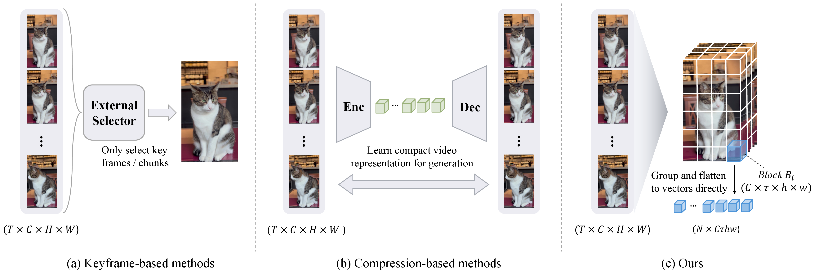

# ReCam

[](https://arxiv.org/abs/2610.27986)

**Recast the Past: Stable Long Video Generation with Full Context Memory**



**Figure 1.** *A coarse read on fine-grained history.* (a) Keyframe-based methods retrieve a subset of observations with an external selector; (b) compression-based methods encode history into a compact representation through a separate
reconstruction stage; (c) ReCam groups and flattens local spatiotemporal blocks directly into memory tokens, letting the video model learn both how to represent the history and how to retrieve it through native attention.

ReCam is a native long-term memory mechanism for autoregressive video generation. It keeps the **entire** video history addressable during rollout with a slow growth of sequence length: local spatiotemporal blocks of historical latents are packed into high-dimensional memory tokens that the Diffusion Transformer reads through its own self-attention. Dual-pointer denoising then keeps that history useful across chunks by exposing the context denoising direction while suppressing errors accumulated in generated frames.

## Quick start

```bash
python -m venv .venv && source .venv/bin/activate
# install a CUDA build of PyTorch for your driver first (see Installation)
pip install -r requirements.txt && export PYTHONPATH="$PWD"

# After placing backbone weights under models/ and a checkpoint under weights/:
CKPT_PATH=weights/recam-14b N_CHUNKS=4 GPUS=0 NPROC_PER_NODE=1 \
  bash scripts/recam/run_infer.sh
```

See [Installation](#installation), [Model weights](#model-weights), and [Inference](#inference) for the full setup.

## Repository layout

```text
core/                  Training infrastructure: config, data, infra, runner
example/recam/
  backbone/            Wan VAE, UMT5 text encoder, flow-matching scheduler
  config/              Dataclass schema for geometry, model, and camera
  datasets/            Parquet window dataset; camera (SpatialVID) variant
  infer/               Autoregressive pipeline, guidance, trajectories, CLI
  models/              ReCam DiT, HistoryMLP, PRoPE attention, flash backends
  trainers/            ReCam and camera-control trainers
configs/recam/         The single experiment recipe (recam.yaml)
scripts/recam/         Training, inference, and camera-training launchers
docs/                  Framework, data, and geometry documentation
assets/demo/           Two clips, two stills, a demo parquet and manifest
```

## Installation

Requirements: Python ≥ 3.10, a CUDA-enabled GPU, and a PyTorch build matching your driver

```bash
python -m venv .venv
source .venv/bin/activate
pip install --upgrade pip
pip install torch --index-url https://download.pytorch.org/whl/cu124  # pick your CUDA
pip install -r requirements.txt
export PYTHONPATH="$PWD"
```

## Model weights

ReCam is initialized from the high-noise expert of Wan2.2-I2V-A14B. Please place the pretrained wights under `models/` at the
default paths or override them on the command line.

| Default path | Contents 
|---|--
| `models/Wan2.1_VAE.pth` | Wan VAE (`WanVideoVAE_2_1`) 
| `models/models_t5_umt5-xxl-enc-bf16.pth` | UMT5-XXL text encoder 
| `models/google/umt5-xxl/` | Tokenizer 

| Recam DiT| Source 
|---|--
| Base Model (480p, 40 steps, w.o. cam ctrl) | Coming soon 
| Base Model (480p, 40 steps, w. cam ctrl) | Coming soon 

A runtime ReCam checkpoint lives in the standard run layout:

```text
runs/recam/checkpoints/step_0002000/
├── model/                 # DiT weights (torch.distributed checkpoint)
├── ema/                   # EMA weights, the default for inference
└── training_state.pt      # global step, optimizer/scheduler/EMA state
```

To train from scratch, point `--checkpoint.pretrained-path` at the high-noise expert state dict of Wan2.2-I2V-A14B; the trainer drops the image-embedding keys that ReCam replaces with its own conditioning path. 

## Data format

Training reads parquet shards whose rows are window sources. Every row must
provide:

| Column | Type | Meaning |
|---|---|---|
| `video_path` | string | Path to the source video (absolute or relative) |
| `src_fps` | float | Source frame rate |
| `caption_start` | int | Caption start, in source frames |
| `caption_end` | int | Caption end, in source frames |
| `text` | string | Dense caption for the segment |

## Training

| Stage | `data.n_chunks` | Max history | Steps | Learning rate |
|---|:---:|:---:|:---:|:---:|
| 1 | 5 | 10 s | 10,000 | `1e-5` |
| 2 | 9 | 20 s | 10,000 | `1e-6` |
| 3 | 13 | 30 s | 10,000 | `1e-6` |

Stage 1:

```bash
MANIFEST=/path/to/parquets_list.txt \
CONFIG_FILE=configs/recam/recam.yaml \
NNODES=8 GPUS_PER_NODE=8 \
  bash scripts/recam/run_train.sh \
  --data.n-chunks 5 \
  --num-steps 10000 \
  --optimizer.learning-rate 1e-5
```

Stage 2 (and similarly stage 3 with `--data.n-chunks 13`). Starting a new stage
from a finished checkpoint creates a fresh optimizer, scheduler, and step count:

```bash
MANIFEST=/path/to/parquets_list.txt NNODES=8 GPUS_PER_NODE=8 \
  bash scripts/recam/run_train.sh \
  --data.n-chunks 9 \
  --num-steps 10000 \
  --optimizer.learning-rate 1e-6 \
  --checkpoint.pretrained-path runs/recam/checkpoints/step_0010000/model
```

For camera control, the camera launcher will automatically swap in the camera trainer.

```bash
CAMERA_PARQUET_DIR=/path/to/camera_parquets \
  bash scripts/recam/camera/run_train.sh \
  --checkpoint.pretrained-path runs/recam/checkpoints/step_0030000/model
```


## Inference

Generate both demo cases:

```bash
CKPT_PATH=weights/recam-14b \
N_CHUNKS=4 GPUS=0 NPROC_PER_NODE=1 \
  bash scripts/recam/run_infer.sh
```

Run a single case (`demo_person_lake` or `demo_cat`) with `CASES=demo_cat`. or use your own images.

```bash
CKPT_PATH=weights/recam-14b N_CHUNKS=4 GPUS=0 NPROC_PER_NODE=1 \
PROMPT_SOURCE= \
  bash scripts/recam/run_infer.sh \
  --prompt "A gray cat peeks out of a brown paper bag." \
  --image path/to/first_frame.png
```

To continue an existing clip:

```bash
CKPT_PATH=weights/recam-14b N_CHUNKS=3 GPUS=0 NPROC_PER_NODE=1 \
PROMPT_SOURCE= \
  bash scripts/recam/run_infer.sh \
  --prompt "The camera follows a person walking along an autumn forest road." \
  --context-video assets/demo/clip_forest.mp4
```

Camera-trajectory inference takes a JSON file mapping each frame index to a camera-to-world `extrinsic` (4×4) and a constant intrinsic matrix `K` (3×3):

```json
{
  "0": {
    "extrinsic": [[1, 0, 0, 0], [0, 1, 0, 0], [0, 0, 1, 0], [0, 0, 0, 1]],
    "K": [[420.0, 0.0, 416.0], [0.0, 420.0, 224.0], [0.0, 0.0, 1.0]]
  }
}
```

Pass it with`--camera-trajectory-file path/to/path.json`.

## License

Released under the [MIT License](LICENSE).
